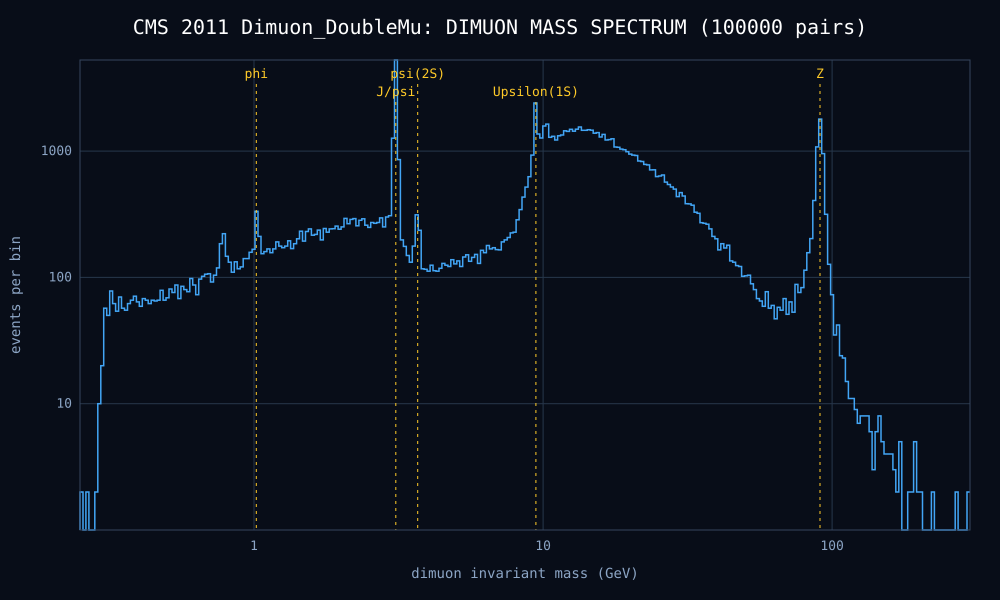

# ORIGIN

A terminal particle observation engine written in Zig (0.17). It is the
computational side of The Coherence Project: it tests the Koide relation
behind `../Lepton coherence` and analyses real collider data from CERN.



## Quick start

Run everything from this `origin/` folder.

```sh
zig build                 # binary at zig-out/bin/origin
zig build test            # unit tests
scripts/fetch.sh          # download CMS open data (~20 MB) into data/raw/
zig-out/bin/origin dataset
zig-out/bin/origin analyze
```

## Commands

| Command | What it does |
|---|---|
| `info` | System and module status |
| `catalogue` | The 12 registered particles: leptons, quarks, hadrons, photon |
| `constants` | CODATA physical constants |
| `observe <particle>` | Mass, charge, class (name or symbol, any case) |
| `koide` | Koide Q, organizational coordinate D and equilibrium Omega per family; normal and inverted neutrino scans; all 336 signed-root fermion triplets ranked by closeness to 2/3 |
| `dataset` | Verifies each downloaded dataset against its published size and adler32 checksum, and counts events |
| `analyze [dataset]` | Dimuon invariant-mass spectrum; finds phi, J/psi, psi(2S), Upsilon, Z and compares with PDG masses. Writes CSV and SVG to `results/` |
| `display [dataset] [event]` | Transverse event display with muon tracks bent by the CMS magnetic field. Writes SVG to `results/` |
| `project [a b c]` | Splits a 3-vector between the identity projector J/3 and the differentiation projector I - J/3. With no arguments: masses, plus PMNS and CKM mixing (no mass) |
| `chart [a b c]` | Draws the triangle and D-axis charts (mass-free) to `results/` and opens them; optional vector is highlighted. `--no-open` to skip opening |
| `weak` | Tests the weak mixing angle: solves for the angle where charged leptons carry exactly 1/3 projection, compares with measured definitions, draws and opens the chart |
| `charge` | Neutrino charge test: derives the B - L charge shift eps allowed with right-handed neutrinos, checks neutrality relations, and converts published limits to bounds on eps |
| `majorana` | Majorana test: effective Majorana mass band for both orderings over all phases, compared with KamLAND-Zen, LEGEND-1000 and nEXO |
| `export` | Writes derived datasets to `datasets/` with a checksummed manifest: per-event dilepton table (160,000 rows, regenerated, not committed), Z -> ee vs Z -> mumu spectra and summary, selection table |
| `universality` | Lepton universality: ORIGIN's Z peak comparison, the CMS efficiency-corrected ee/mumu ratio, and LEP partial widths |
| `generations` | Mass within an entity: Brannen parameters (mu, A, delta) per entity, Koide tau prediction vs measurements, delta vs 2/9 |
| `levels [zeros\|box\|all] [t_max]`, `levels hydrogen [setting] [size]`, `levels strings` | Does a list of energy levels carry the primes? Four checks: line up, gaps (do levels avoid each other), stiffness (does the count wobble over long stretches), loops (hidden repeats; rescaled, do they fall in the same ratios as log 2, log 3, log 5, ...). Inputs: the zeta zeros (computed here), a particle in a box (control), and hydrogen in a strong magnet (levels computed here; about 2 minutes). For hydrogen a fifth check traces the electron's actual closed paths, matches them to the loops, marks repeats, and tests whether the new paths sit in prime ratios. A sixth check runs each loop 1, 2, 3 times and records dip or peak; `levels strings` shows two strings as the reference for where dips come from (a flip at a fixed end alternates trip to trip; the zeros dip on every run). Plain-language readout plus CSV and SVG to `results/` |
| `app` | Opens ORIGIN Explorer in the browser: sliders and presets for your own vector, live triangle and D axis, hover details, data table |
| `science` | Unit system demo |

Datasets: `Zmumu`, `Jpsimumu`, `Ymumu`, `Dimuon_DoubleMu` (default for `analyze`), and `Zee` (Z -> ee).

## Data

CMS Run2011A dimuon events from [CERN Open Data record 545](https://opendata.cern.ch/record/545),
released under CC0. The list of files, sizes and checksums is in
`data/manifests/`. Downloaded files in `data/raw/` are not committed.

## Layout

```
src/science/        constants, units, particle catalogue
src/analysis/       koide, kinematics (four-vectors), spectrum (histograms, peak finding)
src/dataset/        manifest parsing, CSV event import, download verification
src/visualization/  SVG event display and mass spectrum
```
