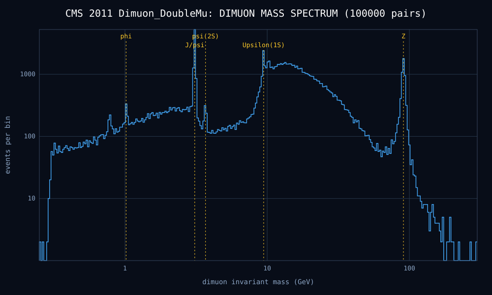

# ORIGIN

A terminal particle observation engine written in Zig (0.17). It is the
computational side of The Coherence Project: it tests the Koide relation
behind `../Lepton coherence` and analyses real collider data from CERN.



## Quick start

Run everything from this `origin/` folder.

```sh
zig build                 # binary at zig-out/bin/origin
zig build test            # unit tests
scripts/fetch.sh          # download CMS open data (~20 MB) into data/raw/
zig-out/bin/origin dataset
zig-out/bin/origin analyze
```

## Commands

| Command | What it does |
|---|---|
| `info` | System and module status |
| `catalogue` | The 12 registered particles: leptons, quarks, hadrons, photon |
| `constants` | CODATA physical constants |
| `observe <particle>` | Mass, charge, class (name or symbol, any case) |
| `koide` | Koide Q, organizational coordinate D and equilibrium Omega per family; normal and inverted neutrino scans; all 336 signed-root fermion triplets ranked by closeness to 2/3 |
| `dataset` | Verifies each downloaded dataset against its published size and adler32 checksum, and counts events |
| `analyze [dataset]` | Dimuon invariant-mass spectrum; finds phi, J/psi, psi(2S), Upsilon, Z and compares with PDG masses. Writes CSV and SVG to `results/` |
| `display [dataset] [event]` | Transverse event display with muon tracks bent by the CMS magnetic field. Writes SVG to `results/` |
| `project [a b c]` | Splits a 3-vector between the identity projector J/3 and the differentiation projector I - J/3. With no arguments: masses, plus PMNS and CKM mixing (no mass) |
| `science` | Unit system demo |

Datasets: `Zmumu`, `Jpsimumu`, `Ymumu`, `Dimuon_DoubleMu` (default for `analyze`).

## Data

CMS Run2011A dimuon events from [CERN Open Data record 545](https://opendata.cern.ch/record/545),
released under CC0. The list of files, sizes and checksums is in
`data/manifests/`. Downloaded files in `data/raw/` are not committed.

## Layout

```
src/science/        constants, units, particle catalogue
src/analysis/       koide, kinematics (four-vectors), spectrum (histograms, peak finding)
src/dataset/        manifest parsing, CSV event import, download verification
src/visualization/  SVG event display and mass spectrum
```
